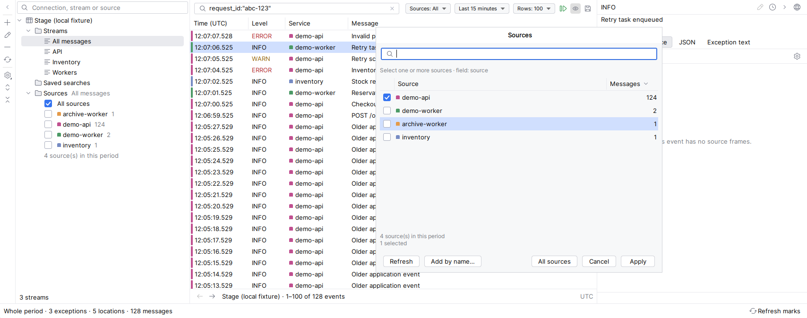
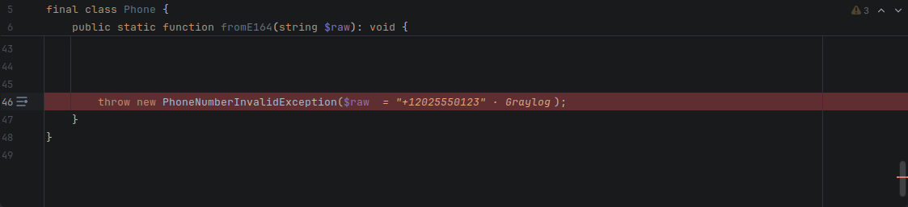

# Graylog Explorer

Search Graylog logs, browse streams and sources, and connect recorded exceptions to local code in JetBrains IDEs.

[](https://github.com/pOmelchenko/idea-graylog-explorer/actions/workflows/ci.yml)
[](LICENSE)

[Русская документация](docs/README.ru.md) · [Changelog](CHANGELOG.md) · [Privacy](PRIVACY.md) · [Report an issue](https://github.com/pOmelchenko/idea-graylog-explorer/issues)

Independent project by Pavel Omelchenko. Not affiliated with Graylog or JetBrains.

## Features

- Browse connections, streams and saved searches in a native IDE tool window.
- Search with field suggestions, absolute search windows, pagination and optional live polling.
- Select multiple sources in the connection tree or a searchable, sortable popup. Source counts cover the query and period, including events outside the loaded page.
- Identify sources with consistent colors; move and resize the Sources popup and retain its size.
- Inspect fields, JSON, readable exception chains and mapped stack frames in separate tabs.
- Open the selected event in the Graylog web interface, show nearby events and follow request IDs.
- Build an exception index across the selected period, independently of table pagination. Gutter markers retain full counts and bounded examples.
- Show exception messages beside source lines. With the PHP plugin, show historical string values beside exception arguments when a lossless constructor template proves the mapping.
- Keep connections and appearance at IDE scope, with source mappings and log profiles at project scope. Store access tokens in the IDE Password Safe.

## Screenshots

Source filtering in a synthetic demo project:



A historical value beside a PHP exception argument:



## Compatibility

- Targets IntelliJ Platform **2026.3**, build **263** only.
- Built and UI-tested with PhpStorm. CI also verifies binary compatibility with IntelliJ IDEA in the same platform line.
- PHP variable hints require the PHP plugin. General log exploration and source-line messages work without it.
- Uses Graylog's legacy search/scroll endpoints and Search Scripting aggregation API. Available endpoints and permissions depend on your server.

Compatibility with older platform versions is not declared. Do not widen the build range without compiling and verifying against those IDEs.

## Install

Marketplace publication is being prepared. Development ZIPs are available in the **plugin-distribution** artifact of a successful [CI run](https://github.com/pOmelchenko/idea-graylog-explorer/actions/workflows/ci.yml). GitHub may require you to sign in to download artifacts.

1. Download and extract the CI artifact to obtain `graylog-jetbrains-<version>.zip`.
2. Open **Settings → Plugins → ⚙ → Install Plugin from Disk…**.
3. Select the plugin ZIP and restart if prompted.
4. Open **View → Tool Windows → Graylog**.

If you installed the earlier local prototype with ID `dev.graylog.jetbrains`, disable or uninstall it before installing the public plugin, whose ID is `dev.omelchenko.graylogexplorer`. Persistent component names are retained, but the two plugin IDs must not be enabled together. Version 0.12.1 declares this incompatibility explicitly. If startup reports that the Graylog window or action is already registered, disable `dev.graylog.jetbrains`, keep `dev.omelchenko.graylogexplorer`, and restart the IDE.

## Updates without restarting the IDE

The plugin uses dynamic extension points and supports installation, updates and removal without a mandatory IDE restart. IntelliJ controls the unload: if it cannot unload a plugin safely, it can still request a restart. The earlier prototype must be disabled or removed before using the public plugin.

An isolated regression test updates an unmodified production JAR in the same IDE process, then unloads and reloads it again. It checks the open Explorer, Live, source popup, exception markers, inline hints, actions and saved query. The classloader leak assertion clears platform icon caches first, since those caches can retain icons beyond a successful unload.

## Connect

1. Add a connection with **+**, or use **Settings → Tools → Graylog Explorer → Connections**.
2. Enter your API URL, for example `https://graylog.example.org/api`, and an access token.
3. Set a separate web URL if the web UI is hosted elsewhere. Reverse-proxy path prefixes are supported.
4. Test the connection and select a stream.
5. Under **Project settings**, map the remote source root, for example `/application`, to your local project root. An empty local root means the project directory.
6. Configure service, exception and request-ID fields when your log schema differs from the defaults. Yii JSON-encoded `ctxt_exception` chains are recognized.

Tokens use Graylog's HTTP Basic access-token mechanism. Browser SSO does not replace an API token. Use HTTPS for remote connections.

Search example:

```text
level:3 AND application:demo
```

Source checkboxes apply immediately; the popup keeps a draft until **Apply**. **All sources** clears the source filter. Source lists exclude their own source selection so you can add another service.

## Exception highlights and values

The background index scans the complete selected search period. A result is published only after export completion and consistency checks; incomplete or changing exports are reported rather than presented as complete.

Select an event and use **Open in Editor**. Each cause is associated with its own origin when the log provides one. PHP variable hints appear after the argument token, such as `$raw`, and are labeled **Graylog**. These represent values recorded in the selected log, not a live debugger session.

The PHP adapter supports a conservative pattern: an exact exception class and source line, `throw new ExceptionClass($variable)`, and a constructor using `parent::__construct(sprintf('literal %s', $parameter))` with one unmodified string parameter. Ambiguous calls, transformations, named arguments, unsaved source files and unmatched templates retain the ordinary source-line message. The source revision must match the deployed service; commit hashes are not checked.

Control hints under **Settings → Tools → Graylog Explorer → Highlighting**, or disable **Code marks** in the tool window. Cancel or refresh the full-period scan from the status bar.

## Language and log-format support

Log exploration is independent of the service language. Structured exception objects/JSON strings (including Yii `ctxt_exception`) and ECS `error` objects normalize to a common exception model. Field aliases remain configurable per project/connection.

Text stack frames recognize PHP, JVM (Java/Kotlin), Python tracebacks, V8 JavaScript/TypeScript, Go, Ruby, .NET and Rust paths. Python cause order and JVM cause headers are normalized for source marks; the Exception text tab retains the complete original text, including native/elided frames. Source mappings and root-confinement checks apply to every language.

JVM frames infer package-relative source paths from the qualified class and the recorded filename. Set the local mapping root to the source directory (for example `src/main/java` or `src/main/kotlin`). The plugin does not guess by basename or search classes through language PSI. Native/unknown-source frames and virtual `node:`/`webpack:`/HTTP URLs remain text. Columns, source maps, Python exception groups and reconstruction of JVM elided frames are not implemented. Source revision matching remains the user's responsibility.

Historical variable values still use the optional, conservative PHP adapter; adding stack parsing does not add variable analysis for another language. Parsers require no optional language plugin. See the [portability review](docs/portability-2026-11-18.md) and [synthetic fixtures](src/test/resources/stacks).

## Build and test

The mixed Java/Kotlin build uses Gradle, JDK **25** and a pinned downloadable PhpStorm SDK:

```bash
./gradlew check buildPlugin verifyPluginStructure verifyPlugin
```

Output: `build/distributions/graylog-jetbrains-<version>.zip`.

To use an installed PhpStorm SDK:

```bash
./gradlew -PideHome=/path/to/phpstorm check buildPlugin verifyPluginStructure verifyPlugin
```

`IDE_HOME` is also supported. The SDK's JBR can supply `JAVA_HOME`. The local-SDK verifier checks that SDK; CI additionally checks the pinned IntelliJ IDEA target. SDK and plugin versions are defined in `gradle.properties`; compiler/build-plugin versions are pinned in `build.gradle`.

The convenience command delegates to the same Gradle build and selects an installed SDK:

```bash
python3 build.py --ide-home /path/to/phpstorm
```

It runs the core HTTP/parser/settings/controller tests and builds the same ZIP. The first build resolves Gradle dependencies; use `--offline` only after they are cached. Run Plugin Verifier explicitly as shown above; this command does not sign the archive.

For real UI smoke tests on Linux, install Xvfb and use a local PhpStorm SDK:

```bash
python3 build.py --ide-home /path/to/phpstorm
python3 scripts/smoke_test.py --ide-home /path/to/phpstorm --theme light --with-legacy-prototype
python3 scripts/smoke_test.py --ide-home /path/to/phpstorm --theme dark --with-legacy-prototype
python3 scripts/smoke_test.py --ide-home /path/to/phpstorm --reload
```

Smoke tests launch a separate IDE with a generated project, a loopback-only fake Graylog service and isolated configuration. Production archives exclude smoke hooks and demo projects. Fixtures contain synthetic example data.

## Architecture

The Explorer coordinates three views: connections, events and event details. Kotlin controllers own submitted search/page/example state, source aggregation/cache and the full-period index. They depend on `GraylogApi` and `TaskRunner` ports; the HTTP client and IntelliJ threading adapter implement those ports. Operations capture deeply immutable effective configuration. Typed IDE/project Settings changes invalidate only affected work. Editor decorations are indexed by file and updated by location, preserving unchanged markers. Both Settings pages use Kotlin UI DSL bindings over detached drafts, while persistent settings beans retain their storage format. Project Apply preserves workspace history.

See [the review and refactoring report](docs/review-2026-11-17.md) for findings, boundaries, retained compatibility code and the 0.14 follow-up.

## Contributing and releases

The manually invoked **Isolated UI smoke tests** workflow exercises both themes against the pinned SDK without a real Graylog server. It requires an IDE startup that can complete without interactive JetBrains Account login; the clean runner currently stops at that screen. Local UI tests use the installed SDK.

See [CONTRIBUTING.md](CONTRIBUTING.md) for development and [docs/PUBLISHING.md](docs/PUBLISHING.md) for the first Marketplace upload, signing secrets and the manually invoked publication workflow. CI runs on pushes and pull requests; Marketplace publication is not triggered by an ordinary push.

Please report security issues privately as described in [SECURITY.md](SECURITY.md). Remove credentials, identifying log data and internal URLs from public reports.

## License and trademarks

[MIT](LICENSE), copyright © 2026 Pavel Omelchenko. See [THIRD_PARTY_NOTICES.md](THIRD_PARTY_NOTICES.md) for build tooling notices. Graylog, JetBrains, IntelliJ IDEA and PhpStorm are trademarks of their respective owners; no affiliation or endorsement is claimed.
