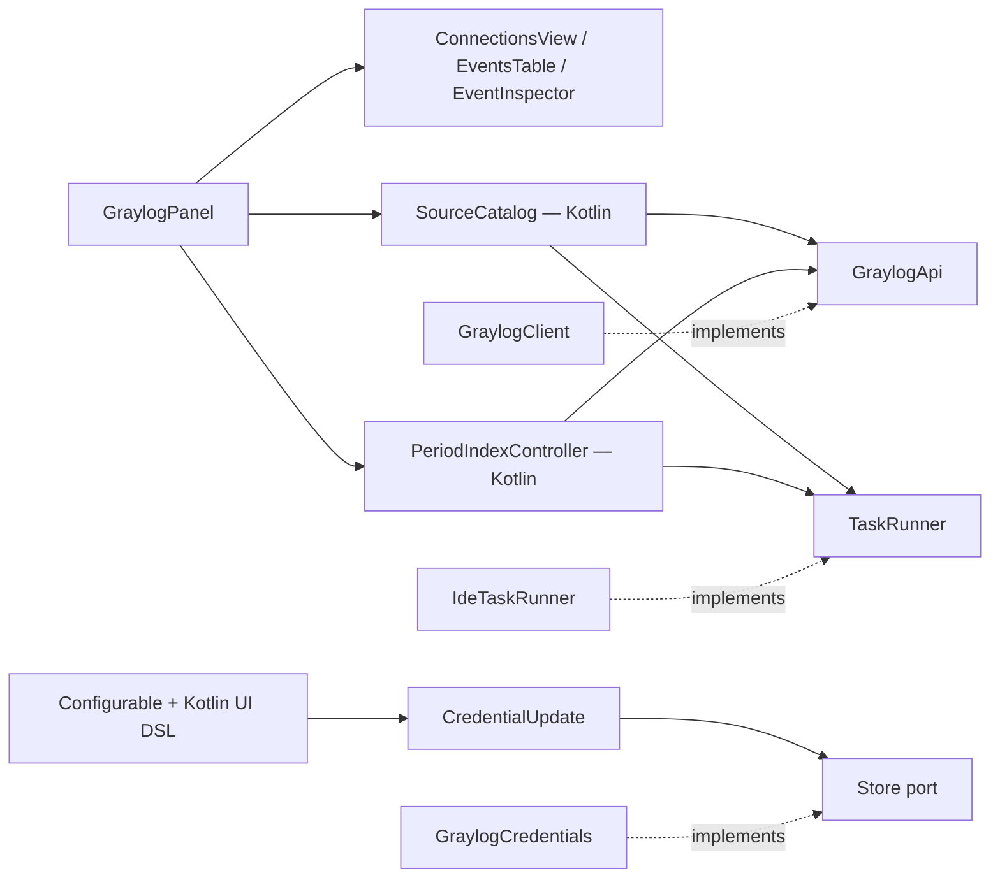

# Ревью и рефакторинг Graylog Explorer

Дата: 2026-11-17. Исходная точка: `c87840c` (0.12.1). Результат: 0.13.0.

## Что показало ревью

Проверены production-классы, сборка, дескрипторы, основные контрактные тесты и сценарии настоящей IDE. В исходной версии было 42 Java-файла и 4157 строк production-кода. Главный долг — смешение обязанностей в `GraylogPanel`, а не выбор Java сам по себе.

| Приоритет | Наблюдение | Результат |
| --- | --- | --- |
| P1 | Границы пагинации проверялись через `offset + limit`: переполнение `int` позволяло обойти лимит | Сравнение без сложения и проверка `Integer.MAX_VALUE` |
| P1 | Произвольный текст лога в tooltip и ячейках мог включать маркер Swing HTML | Tooltip экранирует разметку; таблицы отключают HTML до первого значения. Проверены отсутствие `img` в tooltip и HTML view в рендерерах |
| P2 | `GraylogPanel` совмещал компоновку, дерево, таблицу, инспектор, HTTP, кеш и три потока фоновой работы | Три отдельных представления, два контроллера, API и адаптер исполнения |
| P2 | DTO ответов принадлежали конкретному HTTP-клиенту, фоновые сценарии нельзя было проверить без IDE | `GraylogApi` содержит контракт операций/ответов; контроллеры используют `TaskRunner` |
| P2 | Отмена, поздние ответы и состояние индекса находились в UI; повтор после ошибки мог блокироваться совпадением scope | Контроллеры владеют поколениями запросов, отменой, кешем, повтором и результатом; детерминированные тесты |
| P2 | Запись и откат Password Safe были частью `Configurable.apply()` | `CredentialUpdate` отделяет план/транзакцию от UI; проверены чтение до записи, откат частичной мутации и общие ключи |
| P2 | `build.py` независимо компилировал Java и упаковывал ZIP; Kotlin мог отсутствовать в одной из сборок | Один Gradle-конвейер; Python — CLI-обёртка; UI-тесты получают библиотеки из готового ZIP |
| P2 | Формы вручную воспроизводили GridBag-отступы IDE | Диалог и адаптер Settings перенесены на Kotlin UI DSL |
| P2 | Результат проверки подключения мог появиться после выбора другого подключения | Смена выбора инвалидирует и отменяет предыдущую проверку |
| P2 | Правка подключения/профиля меняла порядок элементов даже без содержательных изменений | Обновление по прежнему индексу |
| P3 | Существовали два алгоритма группировки исключений: страница и поток | Неиспользуемый runtime-алгоритм страницы удалён; тесты группировки используют production Accumulator |
| P3 | На перерисовке создавался форматтер времени; для каждой подсказки — Gson | Общие безопасные для повторного использования экземпляры |
| P3 | Индексатор повторно декодировал цепочку исключения при обработке того же события | Одна декодированная цепочка для наблюдения и подсчёта |
| P2 | Smoke-тест переключал Password Safe после старта; другой plugin мог успеть создать native provider | Memory-only конфигурация записывается до запуска IDE, состояние проверяется перед работой с fixture-токеном |
| P3 | Таймаут диагностического startup-снимка завершал UI-прогон до результата | Сбой вспомогательного снимка записывается отдельно; результат IDE и общий deadline остаются обязательными |
| P3 | Были недостижимые ветки рендерера, всегда истинный параметр `search`, копии рефлексивного helper в smoke-тестах | Удалены/объединены |

В конвейере сборки также устранено дублирование версии дескриптора: Gradle берёт её из `gradle.properties`. Локальный Python-builder и CI больше не создают архивы разными упаковщиками.

P1 обозначает конкретный дефект границы/интерпретации данных, а не подтверждённую эксплуатацию. Исправление проверяет результат разбора Swing, а не только строку реализации.

## Границы после изменений

- `GraylogPanel` остаётся координатором UI: связывает действия, текущую выборку, настройки и подсветку. Он не содержит реализации таблицы/инспектора/дерева и не владеет кешем Sources или состоянием сканирования периода.
- Представления отвечают за собственные компоненты, отрисовку и выбор. Они не делают сетевых запросов.
- Контроллеры не импортируют IntelliJ, AWT или Swing. Их тесты намеренно доставляют ответы уже отменённых задач и прогресс в неудобном порядке.
- `IdeTaskRunner` владеет пулом, переводом callback на UI-поток и жизненным циклом IDE. `GraylogClient` владеет HTTP, авторизацией и особенностями Graylog API.
- `CredentialUpdate` не знает о Password Safe и Settings Dialog; адаптер выполняет фактический доступ к хранилищу в фоне.

Это применение SRP и DIP в одном небольшом плагине. Отдельные Gradle-модули, DI-контейнер, интерфейс для каждого класса и универсальный repository/use-case каркас здесь не введены: они не нужны для полученных границ и тестов.

## Размеры и Kotlin

| Компонент | До | После |
| --- | ---: | ---: |
| `GraylogPanel` | 1014 | 607 |
| `EventInspector` | часть Panel | 199 |
| `ConnectionsView` | часть Panel | 185 |
| `EventsTable` | часть Panel | 95 |
| `SourceCatalog` (Kotlin) | часть Panel | 73 |
| `PeriodIndexController` (Kotlin) | часть Panel | 56 |
| `ConnectionDialog` | 78 Java | 58 Kotlin |
| `SettingsForms` | 80 Java | 94 Kotlin |
| `CredentialUpdate` | часть Configurable | 51 |
| Весь production-код | 42 файла / 4157 строк | 51 файл / 4459 строк |

Строки включают импорты и комментарии; это ориентир, а не оценка сложности. Panel уменьшился на 40%. Общий объём вырос примерно на 7% за счёт явных портов, жизненного цикла и состояния; формы используют стандартный layout. `GraylogPanel` всё ещё крупнее остальных: в нём осталась связка UI-команд, выборки и настроек. Новый самостоятельный сценарий следует добавлять в соответствующий компонент/контроллер, а не расширять этот класс без оценки ответственности.

На Kotlin перенесены `ConnectionDialog`, `SettingsForms`, `SourceCatalog` и `PeriodIndexController`. Это формы с прямой пользой от UI DSL и код с компактным выражением состояния. Сборка поддерживает смешанный Java/Kotlin-проект; stdlib берётся из IDE и не включается второй копией в ZIP.

Не переписаны механически Java records и парсеры: их текущая форма компактна и покрыта контрактными проверками. `GraylogIdeConfigurable` и `GraylogProjectConfigurable` — следующие возможные кандидаты для полной миграции на Kotlin; сейчас они уже используют нативный DSL через адаптер, а дополнительная смена синтаксиса не является условием архитектурного разделения.

## Что сохранено и почему

- Старые поля `Connection` / `GraylogSettings.Data`, схема миграции и tombstone-список удалённых подключений нужны для проектов, которые ещё не открывались после перехода к IDE-wide settings. Удаление может потерять настройки или воскресить удалённый сервер.
- ID плагина, имена persistent-компонентов, ключи Password Safe и формат сохранённых данных сохранены.
- Legacy search/terms fallback, CSV scroll, JSON-восстановление структурированных исключений и проверки эффективного окна/числа строк защищают полноту индекса. Они не заменены загрузкой видимой страницы.
- Ограничение числа примеров на строку, CSV-ограничения, нормализация путей и защита от выхода за локальный root сохранены.
- Консервативные условия PHP-подсказок сохранены. Произвольное извлечение значения из сообщения не доказывает привязку к переменной.
- Небольшие `GraylogLinks`, `SourceFilter`, `LoggedStringTemplate`, `CsvRecords` имеют самостоятельные контракты и причины изменения; объединять их ради уменьшения числа файлов не требуется.

## Оставшиеся улучшения

1. При новых изменениях Settings можно перенести сами Configurable на Kotlin целиком и заменить оставшееся ручное чтение контролов привязками DSL. Формат persistent state при этом следует сохранить.
2. Часть UI-регрессий всё ещё использует рефлексию. Общий helper объединён, но устойчивые проверки по действиям/компонентам предпочтительнее для следующих сценариев.
3. `GraylogClient` остаётся сравнительно крупным, но объединяет один адаптер внешнего API. Выделять export-adapter стоит при добавлении второго протокола, а не только из-за количества строк.
4. Удаление старой схемы миграции требует отдельного решения о поддерживаемых версиях и проверки сохранённых workspace-файлов.

## Проверки

Локальная проверка выполнена на PhpStorm `263.7307.215`:

- `check`: 452 контрактных проверок, включая HTTP/CSV, полный период, миграцию, пути, отмену/поздние ответы контроллеров, откат Password Safe, переполнение пагинации, Swing tooltip и plain-text ячейки.
- `buildPlugin`, `verifyPluginStructure`, `verifyPlugin`: успешны. Plugin Verifier подтвердил совместимость с указанной локальной IDE и возможность динамического включения/выключения.
- Полные UI-сценарии под Xvfb прошли в светлой и тёмной темах: поиск, пагинация, дерево Sources, фильтры, инспектор, переходы, PHP-подсказки, очистка и 37 проверок Settings в каждой теме. Новый Kotlin-диалог отдельно проверен на валидацию, нормализацию URL, редактирование копии и очистку токена.
- Независимый reload-controller обновил production-плагин и повторно загрузил его в той же JVM. Проверены открытый Explorer, Live, popup Sources, индекс, PHP-подсказки, действия и сохранённый запрос. Оба старых classloader освобождены после явной очистки платформенного кеша иконок; это условие теста, а не обещание немедленной сборки классов в любой IDE.
- Проверен ZIP `graylog-jetbrains-0.13.0.zip`: одна runtime-библиотека с Java/Kotlin-классами, без второй Kotlin stdlib, smoke/reload fixtures и старых DTO; версия дескриптора — `0.13.0`.

UI-отчёты и снимки создаются в `build/reports/smoke/{light,dark,reload}`. CI дополнительно проверяет закреплённые SDK PhpStorm `263.7307.51` и IntelliJ IDEA `263.7307.44`; локальная проверка новой IDE не подменяет эти результаты. Реальный Graylog и пользовательский Password Safe в изолированных UI-тестах не используются.

В [CI-прогоне UI](https://github.com/pOmelchenko/idea-graylog-explorer/actions/runs/44121252628) чистый EAP SDK остановился на JetBrains EAP User Agreement до открытия проекта. Этот прогон не подтверждает работу UI в CI. Владелец разрешил принять встроенную версию 3.1 для изолированных тестов; CI передаёт явный `--accept-eap-agreement 3.1`. Runner сверяет версию документа и записывает согласие только в отдельный каталог Java preferences. Иная версия требует нового решения. Локальные UI-результаты относятся к указанной выше установленной IDE.

Платформенные ссылки: [Kotlin support](https://plugins.jetbrains.com/docs/intellij/using-kotlin.html), [Kotlin UI DSL](https://plugins.jetbrains.com/docs/intellij/kotlin-ui-dsl-version-2.html), [dynamic plugins](https://plugins.jetbrains.com/docs/intellij/dynamic-plugins.html).
